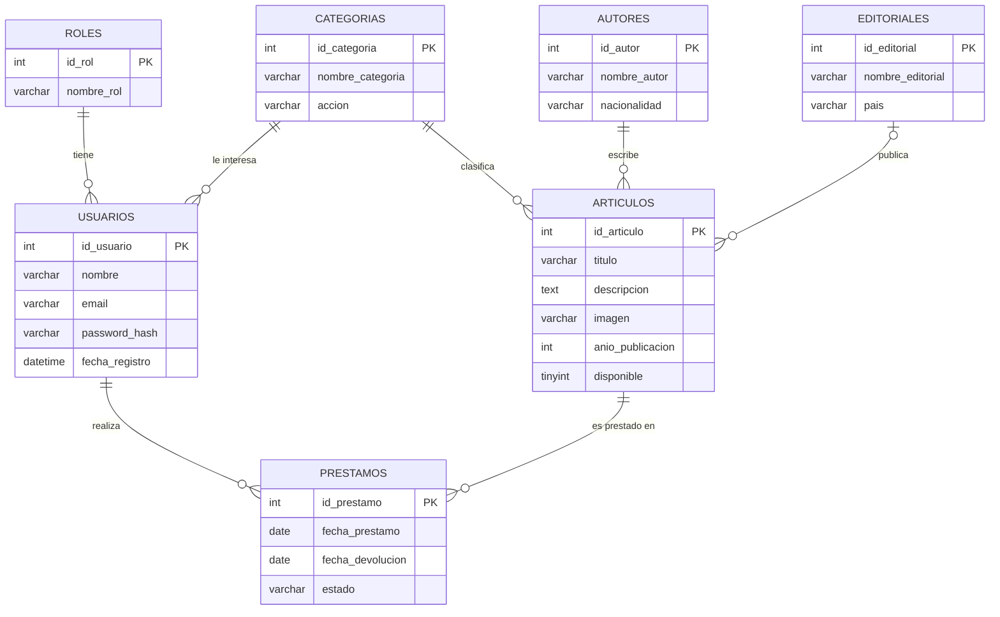

# Modelo Entidad-Relación (MER)

La landing del Práctico 1 tiene un catálogo de artículos (libros, revistas y audiolibros) con título, autor, categoría e imagen. Los usuarios se registran con nombre, correo, contraseña e interés, inician sesión y tienen un rol (Administrador o Usuario). Además los usuarios piden prestados los artículos de la biblioteca.

## Diagrama

PRESTAMOS es la relación N:N entre USUARIOS y ARTICULOS y tiene atributos propios (fechas y estado).

## Entidades y atributos

| Entidad | Clave primaria | Atributos |
|---|---|---|
| **ROLES** | id_rol | nombre_rol |
| **USUARIOS** | id_usuario | nombre, email, password_hash, fecha_registro |
| **CATEGORIAS** | id_categoria | nombre_categoria, accion |
| **AUTORES** | id_autor | nombre_autor, nacionalidad |
| **EDITORIALES** | id_editorial | nombre_editorial, pais |
| **ARTICULOS** | id_articulo | titulo, descripcion, imagen, anio_publicacion, disponible |
| **PRESTAMOS** | id_prestamo | fecha_prestamo, fecha_devolucion, estado |

## Relaciones y cardinalidades

| Relación | Entidades | Cardinalidad | Lectura |
|---|---|---|---|
| tiene | ROLES y USUARIOS | 1 : N | Un rol lo tienen muchos usuarios; cada usuario tiene un solo rol. |
| le interesa | CATEGORIAS y USUARIOS | 1 : N | Una categoría puede interesarle a muchos usuarios; cada usuario elige como máximo una. |
| clasifica | CATEGORIAS y ARTICULOS | 1 : N | Una categoría agrupa muchos artículos; cada artículo pertenece a una categoría. |
| escribe | AUTORES y ARTICULOS | 1 : N | Un autor escribe muchos artículos; cada artículo tiene un autor. |
| publica | EDITORIALES y ARTICULOS | 1 : N | Una editorial publica muchos artículos; un artículo puede tener una o ninguna editorial. |
| pide prestado (PRESTAMOS) | USUARIOS y ARTICULOS | N : M | Un usuario puede pedir muchos artículos y un artículo puede ser prestado a muchos usuarios a lo largo del tiempo. |
